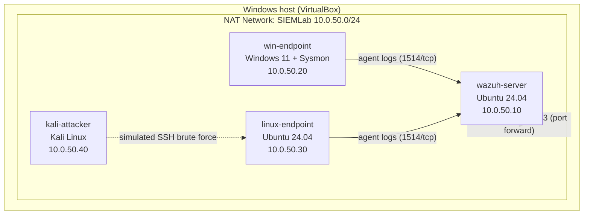

# 🛡️ SIEM & Log Analysis Home Lab

### Wazuh-based threat detection across Windows and Linux, mapped to MITRE ATT&CK

**[Build Status](#-build-status) · [Architecture](#️-lab-architecture) · [Detections](#-what-this-lab-detects) · [In Depth](#-detections-in-depth) · [Attack Chain](#️-attack-chain-simulated) · [Investigations](#-analyst-triage--investigations) · [Dashboard](#-soc-dashboard) · [Lab Series](#-other-labs-in-this-series)**

---

This is the first lab in my cybersecurity home lab series. I deploy the [Wazuh](https://wazuh.com/) SIEM on an isolated virtual network, forward Windows and Linux telemetry into it, run safe attacker simulations against my own VMs, and write custom detection rules to catch them. The goal is to practice the day-to-day work of a SOC analyst: collecting logs, engineering detections, and investigating alerts. It is being built in phases, and this write-up is updated as each phase is completed.

---

## 🚧 Build Status

This lab is in active development. The sections below describe the full design; the checklist shows what is actually stood up so far.

- [x] Lab designed: architecture, detection rules authored, attack simulations scripted
- [x] Host prep: VirtualBox 7.1 installed, VT-x enabled in BIOS, OS images downloaded (Ubuntu 24.04.5, Windows 11 Enterprise eval, Kali)
- [x] Lab network created: `SIEMLab` NAT network (10.0.50.0/24) with host port forwards
- [x] VM shells created and attached to the lab network: `wazuh-server`, `win-endpoint`, `linux-endpoint`
- [x] `wazuh-server`: Ubuntu Server 24.04 installed, static IP 10.0.50.10, OpenSSH enabled
- [x] `linux-endpoint`: Ubuntu Server 24.04 installed, static IP 10.0.50.30
- [ ] `win-endpoint`: Windows 11 installed and given a static IP
- [ ] Kali attacker VM imported
- [x] Wazuh server deployed (manager, indexer, dashboard); dashboard reachable at `https://localhost:8443`
- [ ] Windows agent + Sysmon reporting
- [x] Linux agent reporting (`linux-endpoint`, agent 001, active)
- [ ] Custom detection rules loaded and validated
- [ ] Attack simulations executed and alerts confirmed
- [ ] Dashboard built and investigations written up

> 💡 The full step-by-step build guide lives in [`docs/`](docs/), one file per phase. A running [build log](docs/build-log.md) records what was actually done and the problems hit along the way (VT-x, LVM disk space, port conflicts). This README is the portfolio write-up; the docs are the how-to.

*The Wazuh SIEM running on the lab server. Endpoints and detections come next; agent telemetry will populate the severity counts.*

---

## 🗺️ Lab Architecture

Four VMs on a VirtualBox NAT network. The VMs can reach each other and the internet, but nothing on my home network can reach them.

| Node | Role | OS | vCPU | RAM | Disk | IP |
|---|---|---|---|---|---|---|
| `wazuh-server` | SIEM: manager, indexer, dashboard | Ubuntu Server 24.04 LTS | 4 | 8 GB | 60 GB | 10.0.50.10 |
| `win-endpoint` | Monitored Windows host (Sysmon) | Windows 11 Enterprise (eval) | 2 | 6 GB | 64 GB | 10.0.50.20 |
| `linux-endpoint` | Monitored Linux host | Ubuntu Server 24.04 LTS | 1 | 2 GB | 25 GB | 10.0.50.30 |
| `kali-attacker` | Attacker | Kali Linux | 2 | 4 GB | 40 GB | 10.0.50.40 |

**Log sources:** Windows Security (logon and account events), Sysmon Operational (process creation), PowerShell Operational (script block logging), and Linux `auth.log` (SSH and sudo).

---

## 🎯 What This Lab Detects

Five custom rules sit on top of Wazuh's built-in ruleset, each mapped to a MITRE ATT&CK technique. They are authored in [`configs/local_rules.xml`](configs/local_rules.xml) and validated once the agents are live (see Build Status).

| # | Detection | Tactic | Technique | Log source | Severity |
|---|---|---|---|---|---|
| 1 | PowerShell run with an encoded command | Execution | [T1059.001](https://attack.mitre.org/techniques/T1059/001/) | Sysmon EID 1 | High (13) |
| 2 | PowerShell downloading from the web | Command & Control | [T1105](https://attack.mitre.org/techniques/T1105/) | Sysmon EID 1 | Medium (10) |
| 3 | Scheduled task created via schtasks | Persistence | [T1053.005](https://attack.mitre.org/techniques/T1053/005/) | Sysmon EID 1 | Medium (10) |
| 4 | Account added to local Administrators | Persistence | [T1098](https://attack.mitre.org/techniques/T1098/) | Windows Security 4732 | High (12) |
| 5 | `/etc/shadow` read with sudo | Credential Access | [T1003.008](https://attack.mitre.org/techniques/T1003/008/) | Linux auth.log | High (12) |

> 📄 Rule logic was validated against the Wazuh 4.14 ruleset source. Rule #1 is deliberately set to level 13 so it is evaluated ahead of the built-in encoded-PowerShell rule (level 12) and wins as the surfaced alert.

*Screenshot placeholder: Wazuh Threat Hunting view with the five custom rules firing (added once Phase 6 is complete).*

---

## 🔬 Detections In Depth

### 1. Encoded PowerShell `T1059.001`

Attackers base64-encode PowerShell commands to hide intent from casual log review. The rule keys on `powershell.exe` with an `-EncodedCommand` argument (and its abbreviations) in the Sysmon process-creation event, while deliberately not matching benign `-ExecutionPolicy`. Triage means decoding the command and checking the parent process.

*Screenshot placeholder: decoded encoded-command alert (added once validated).*

### 2. PowerShell Web Download `T1105`

Catches PowerShell pulling a remote file via `Invoke-WebRequest`, `DownloadString`, `DownloadFile`, or `Net.WebClient`. Often the first stage of a payload drop. Correlating this with detection #1 (encoded command) strengthens the signal.

### 3. Scheduled Task Persistence `T1053.005`

A scheduled task created with `schtasks /create` is a classic persistence foothold. The rule flags task creation from the command line so it can be tied back to the process that made it.

### 4. Local Administrators Change `T1098`

Adding an account to the local Administrators group (Windows Security Event 4732) is both privilege escalation and persistence. The rule narrows to the Administrators group specifically.

### 5. Shadow File Access `T1003.008`

Reading `/etc/shadow` dumps Linux password hashes for offline cracking. The rule fires when the file is accessed through sudo, building on Wazuh's built-in sudo decoders.

---

## ⚔️ Attack Chain Simulated

All simulations run against my own VMs on the isolated network, using harmless stand-in payloads so the logs are realistic without real damage.

**Windows:** `Brute force (10 failed logons) → Discovery (whoami / net) → Encoded PowerShell → Web download → Priv-esc (add to Administrators) → Persistence (scheduled task)`

**Linux:** `SSH brute force → Credential access (/etc/shadow via sudo) → Backdoor account → sudo group`

> 💡 The "malicious" payloads are benign by design: the encoded command decodes to `whoami; hostname`, the scheduled task only echoes text, and the brute-force wordlist and target account exist only inside the lab. Each script has a cleanup switch, and VMs are snapshotted to a `clean-baseline` first. Scripts: [`scripts/`](scripts/).

---

## 🧪 Analyst Triage & Investigations

For each detection I write up a short investigation the way a SOC analyst would: what fired, what actually happened (reconstructed from surrounding events), whether it is malicious, the response, and how to tune the rule. The template and the first worked example are in [`docs/07-dashboard-and-investigations.md`](docs/07-dashboard-and-investigations.md).

*Investigation write-ups are added here as each attack is run and confirmed.*

---

## 📊 SOC Dashboard

A Wazuh dashboard planned to summarize the lab at a glance:

- Top triggered rules by count
- Alerts over time, split by host
- Highest alert level (gauge)
- MITRE ATT&CK techniques observed

*Screenshot placeholder: SIEM Lab Overview dashboard (added once Phase 7 is complete).*

---

## 🛠️ Tools & Stack

**Wazuh 4.14** (SIEM / XDR) · **VirtualBox 7.1** (hypervisor) · **Ubuntu Server 24.04 LTS** · **Windows 11 Enterprise** with **Sysmon** (SwiftOnSecurity config) · **Kali Linux** with **Hydra** · **PowerShell** and **Bash** for simulation and cleanup · **MITRE ATT&CK** for technique mapping.

---

## 🤖 Using Claude as a Tool

I used Claude (Anthropic) as an assistant to scaffold this lab: drafting the detection rules, the simulation scripts, and this documentation, and checking the rule logic against the Wazuh ruleset. I am building, running, and validating every component myself, and no detection is marked working here until I have confirmed it fire in my own environment. Treating AI as a force multiplier while verifying its output is part of how I work.

---

## 📚 Other Labs in This Series

| # | Lab | Focus | Status |
|---|---|---|---|
| **1** | **SIEM & Log Analysis** | **Wazuh, log ingestion, custom detections, dashboards** | **In progress** |
| 2 | Network Traffic Analysis | Packet capture and analysis with Wireshark | Planned |
| 3 | Vulnerability Scanning | Scanning a test network, prioritizing findings | Planned |
| 4 | Incident Response Practice | Simulated incident, timeline, and write-up | Planned |
| 5 | Active Directory Home Lab | Building a small AD domain and studying common attacks | Planned |

---

Built by Justin Nguyen · Pursuing CompTIA A+ and Security+ · Part of an ongoing cybersecurity home lab series.
