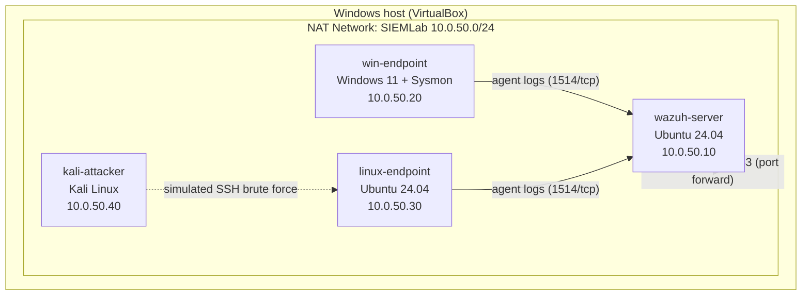
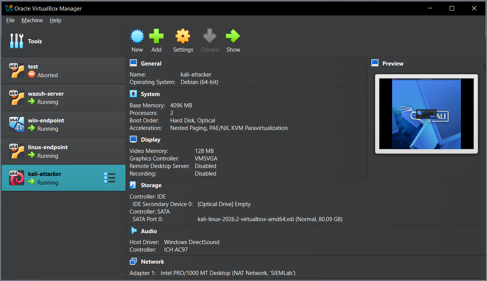
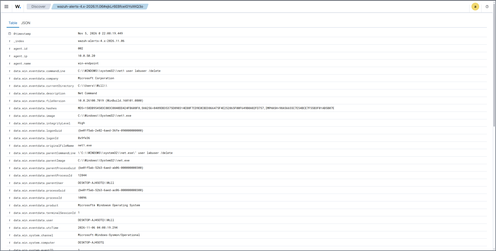
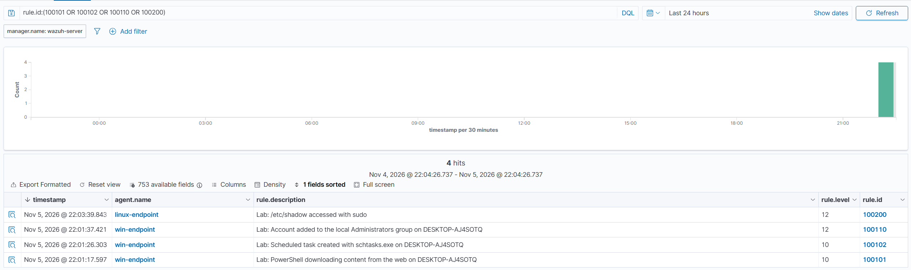
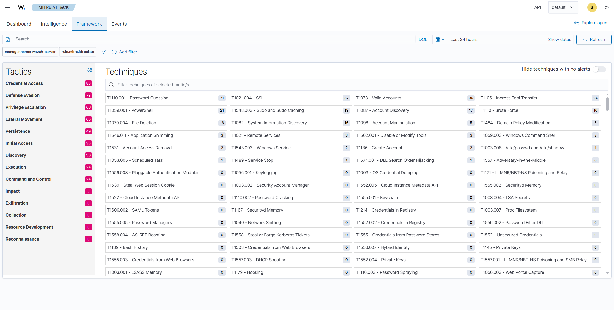
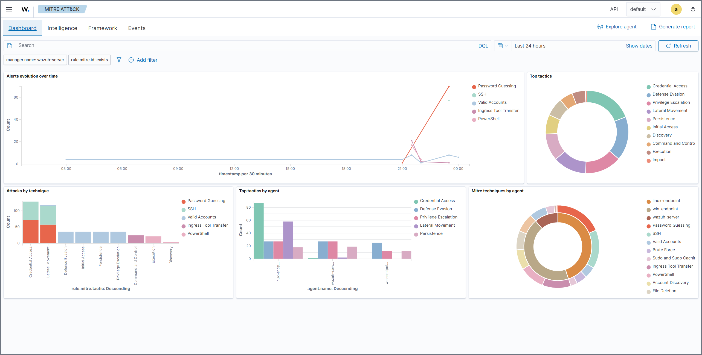
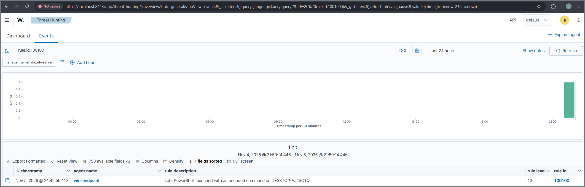
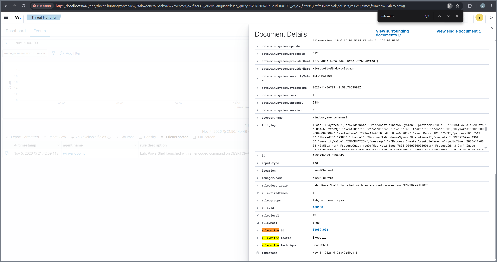
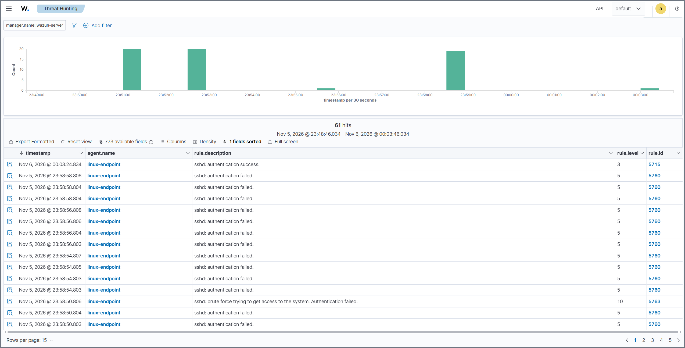
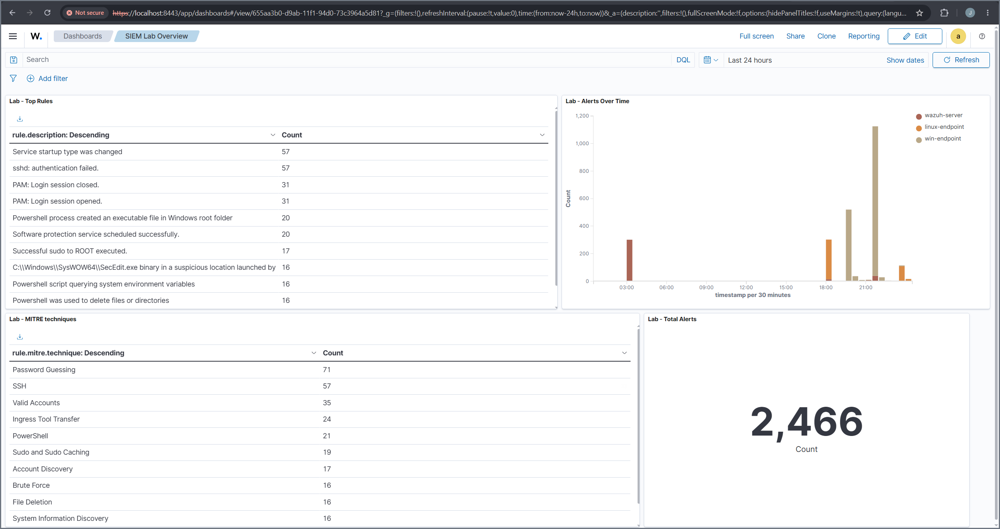

<div align="center">

# 🔐 SIEM & Log Analysis Home Lab

**A hands-on Wazuh SIEM that ingests Windows and Linux telemetry, detects attacker techniques with custom rules, and traces each one back through the logs, the way a SOC analyst works.**


[Status](#-project-status) • [Environment](#-the-lab-environment) • [How Detection Works](#-how-detection-works-in-wazuh) • [Coverage](#-detection-coverage) • [Rules](#-rule-by-rule-breakdown) • [Simulations](#-adversary-simulations) • [Investigations](#-investigating-the-alerts) • [Dashboards](#-visibility-and-dashboards) • [Challenges](#-challenges-and-how-i-solved-them) • [Skills](#-skills-demonstrated)

</div>

---

I built this lab to learn detection engineering by doing it rather than reading about it. I set up the [Wazuh](https://wazuh.com/) SIEM on an isolated virtual network, pointed Windows and Linux agents at it, ran safe attacker simulations against my own machines, and wrote custom rules to catch each technique. Every detection here was triggered on purpose and confirmed in my own environment, and each one is written up the way an analyst would hand it off: what fired, what actually happened, and what to do about it.

This README is the walkthrough. The [`docs/`](docs/) folder holds the phase-by-phase build guide, and [`docs/build-log.md`](docs/build-log.md) is the honest running log of what I actually did, including everything that broke.

---

## ✅ Project Status

Every phase is complete: the environment is built, both endpoints report in, all five custom rules are validated against live attacks, the SSH brute force is detected end to end, the dashboard is built, and the detections are written up.

- [x] Isolated lab network (`SIEMLab`, 10.0.50.0/24) and four VMs built in VirtualBox
- [x] Wazuh server deployed (manager, indexer, dashboard) and reachable from the host
- [x] `win-endpoint` reporting with Sysmon, audit policies, and PowerShell logging
- [x] `linux-endpoint` reporting with the Wazuh agent
- [x] Five custom detection rules authored, loaded, and mapped to MITRE ATT&CK
- [x] All five rules validated by Windows and Linux attack simulations
- [x] Kali attacker imported; SSH brute force detected (rules 5760 / 5763 / 5715)
- [x] Custom SOC overview dashboard built
- [x] Three detections written up analyst-style with tuning notes

---

## 🌐 The Lab Environment

Four virtual machines on a VirtualBox NAT network.



| Node | Role | OS | vCPU | RAM | Disk | IP |
|---|---|---|---|---|---|---|
| `wazuh-server` | SIEM: manager, indexer, dashboard | Ubuntu Server 24.04 LTS | 4 | 8 GB | 60 GB | 10.0.50.10 |
| `win-endpoint` | Monitored Windows host (Sysmon) | Windows 11 Enterprise (eval) | 2 | 6 GB | 64 GB | 10.0.50.20 |
| `linux-endpoint` | Monitored Linux host | Ubuntu Server 24.04 LTS | 1 | 2 GB | 25 GB | 10.0.50.30 |
| `kali-attacker` | Attacker | Kali Linux | 2 | 4 GB | 40 GB | 10.0.50.40 |

> [!IMPORTANT]
> The whole lab lives on an isolated NAT network. The VMs can reach each other and the internet, but nothing on my home network can reach them, so the simulated attacks stay fully contained.

**Host access (NAT port forwards):** the isolated network is reachable from the host only through a few mapped ports.

| Host | Forwards to | Purpose |
|---|---|---|
| `127.0.0.1:8443` | `10.0.50.10:443` | Wazuh dashboard |
| `127.0.0.1:2210` | `10.0.50.10:22` | SSH to the Wazuh server |
| `127.0.0.1:2230` | `10.0.50.30:22` | SSH to the Linux endpoint |

**Log sources:** Windows Security (logon and account events), Sysmon Operational (process creation), PowerShell Operational (script-block logging), and Linux `auth.log` (SSH and sudo).

<div align="center">
  <a href="screenshots/17-all-vms.png"></a><br>
  <em>The four lab VMs in VirtualBox, all attached to the isolated SIEMLab network.</em>
</div>

---

## 🧠 How Detection Works in Wazuh

A quick mental model, since it is what the rest of the lab builds on.

- **Events flow through a rule tree.** Decoders first tag a raw log (for example, a Sysmon process-creation event or an sshd authentication line). Custom rules then attach to those tags with `if_group` or `if_sid`, so a rule only runs against events it can possibly match. That keeps custom rules cheap and precise instead of scanning everything.
- **MITRE mapping is automatic.** Adding a `<mitre>` block to a rule makes Wazuh populate `rule.mitre.id`, `rule.mitre.tactic`, and `rule.mitre.technique` from its ATT&CK database, so every alert is tagged with the technique it represents.

> [!TIP]
> Rule level doubles as a tie-breaker. When several rules match the same event, Wazuh surfaces the highest-level one, so I set my encoded-PowerShell rule to level 13 to win over the built-in level-12 rule and become the alert an analyst sees.

The rules match on real telemetry. A single Sysmon process-creation event carries the full command line, file hashes, the parent process, and the user, which is exactly the context an analyst needs.

<div align="center">
  <a href="screenshots/20-sysmon-event-1.png"></a><br>
  <em>One Sysmon process-creation event: command line, hashes, parent process, and user, the raw data the rules key on.</em>
</div>

---

## 📡 Detection Coverage

Five custom rules sit on top of Wazuh's built-in ruleset, each tied to a MITRE ATT&CK technique and a specific log source. They are authored in [`configs/local_rules.xml`](configs/local_rules.xml).

| # | Rule ID | Detection | Tactic | Technique | Log source | Severity |
|---|---|---|---|---|---|---|
| 1 | 100100 | PowerShell run with an encoded command | Execution | [T1059.001](https://attack.mitre.org/techniques/T1059/001/) | Sysmon EID 1 | High (13) |
| 2 | 100101 | PowerShell downloading from the web | Command & Control | [T1105](https://attack.mitre.org/techniques/T1105/) | Sysmon EID 1 | Medium (10) |
| 3 | 100102 | Scheduled task created via schtasks | Persistence | [T1053.005](https://attack.mitre.org/techniques/T1053/005/) | Sysmon EID 1 | Medium (10) |
| 4 | 100110 | Account added to local Administrators | Persistence | [T1098](https://attack.mitre.org/techniques/T1098/) | Windows Security 4732 | High (12) |
| 5 | 100200 | `/etc/shadow` read with sudo | Credential Access | [T1003.008](https://attack.mitre.org/techniques/T1003/008/) | Linux auth.log | High (12) |

> [!NOTE]
> Each rule's logic was validated against the Wazuh 4.14 ruleset source before going live, so it keys on the right fields and does not collide with the built-in rules.

<div align="center">
  <a href="screenshots/14-all-custom-rules.png"></a><br>
  <em>Four of the five custom rules firing from the simulations (web download, scheduled task, local-admin change, and the Linux /etc/shadow read). The encoded-PowerShell rule is shown in the next section.</em>
</div>

Wazuh's MITRE ATT&CK module maps every alert onto the matrix, which shows the breadth of behavior the lab exercises across both endpoints.

<div align="center">
  <a href="screenshots/18-mitre-framework.png"></a><br>
  <em>The ATT&CK framework view, techniques lit up by the simulations, from Password Guessing and SSH to PowerShell, Ingress Tool Transfer, Scheduled Task, and /etc/shadow access.</em>
  <br><br>
  <a href="screenshots/19-mitre-dashboard.png"></a><br>
  <em>The MITRE dashboard: tactics and techniques broken down by host, so each adversary behavior traces back to where it happened.</em>
</div>

---

## 🧩 Rule-by-Rule Breakdown

**1. Encoded PowerShell — `T1059.001`.** Attackers base64-encode PowerShell commands to hide intent from casual log review. The rule keys on `powershell.exe` with an `-EncodedCommand` argument (and its abbreviations) in the Sysmon process-creation event, while deliberately ignoring the benign `-ExecutionPolicy`. Triage means decoding the command and checking the parent process.

<div align="center">
  <a href="screenshots/12-detection-encoded-ps-table.png"></a><br>
  <em>Rule 100100 (level 13) firing on win-endpoint for an encoded PowerShell command.</em>
  <br><br>
  <a href="screenshots/13-detection-encoded-ps-detail.png"></a><br>
  <em>The alert detail: the Sysmon event, the rule groups, and the auto-populated MITRE mapping (T1059.001, Execution, PowerShell).</em>
</div>

**2. PowerShell Web Download — `T1105`.** Catches PowerShell pulling a remote file via `Invoke-WebRequest`, `DownloadString`, `DownloadFile`, or `Net.WebClient`, often the first stage of a payload drop. Correlating it with the encoded-command rule strengthens the signal.

**3. Scheduled Task Persistence — `T1053.005`.** A scheduled task created with `schtasks /create` is a classic persistence foothold. The rule flags task creation from the command line so it can be tied back to the process that made it.

**4. Local Administrators Change — `T1098`.** Adding an account to the local Administrators group (Windows Security Event 4732) is both privilege escalation and persistence. The rule narrows specifically to the Administrators group so routine group changes stay quiet.

**5. Shadow File Access — `T1003.008`.** Reading `/etc/shadow` dumps Linux password hashes for offline cracking. The rule fires when the file is read through sudo, building on Wazuh's built-in sudo decoders.

---

## 💥 Adversary Simulations

Scripts are in [`scripts/`](scripts/).

**Windows chain:** `Brute force (failed logons) → Discovery (whoami / net) → Encoded PowerShell → Web download → Privilege escalation (add to Administrators) → Persistence (scheduled task)`

**Linux chain:** `SSH brute force → Credential access (/etc/shadow via sudo) → Backdoor account → sudo group`

> [!NOTE]
> The payloads are benign by design: the encoded command only runs `whoami; hostname`, the scheduled task just echoes text, and the brute-force wordlist and target account exist only inside the lab. The point is realistic logs, not real damage.

> [!WARNING]
> These simulations run only against my own isolated VMs. The techniques themselves are real, so only point attack tooling like Hydra at systems you own and control.

The SSH brute force is the clearest end-to-end story: a burst of failures, the correlation alert, and then a successful login with the cracked password, exactly the sequence an analyst pivots on.

<div align="center">
  <a href="screenshots/15-ssh-bruteforce.png"></a><br>
  <em>The SSH brute force from Kali against linux-endpoint: failed logins (5760), the brute-force correlation alert (5763, level 10), and the successful login with the cracked credentials (5715).</em>
</div>

---

## 🔎 Investigating the Alerts

For each detection I wrote a short investigation the way a SOC analyst would hand it off: what triggered it, what actually happened, whether it is malicious, the response, and how the rule could be tuned. Full write-ups: [`docs/investigations.md`](docs/investigations.md).

| # | Investigation | ATT&CK | Host | Verdict |
|---|---|---|---|---|
| 1 | Encoded PowerShell command (rule 100100) | T1059.001 | win-endpoint | Malicious technique; benign payload in this run |
| 2 | SSH brute force into a successful login (5763 → 5715) | T1110.001 → T1078 | linux-endpoint | Malicious; account treated as compromised |
| 3 | Account added to local Administrators (rule 100110) | T1098 | win-endpoint | Malicious; unauthorized privilege escalation |

Each one closes with a tuning note: where the rule could false-positive, where to raise severity, and what extra context makes the alert higher fidelity.

---

## 📈 Visibility and Dashboards

I built a custom **SIEM Lab Overview** dashboard in Wazuh to summarize the environment at a glance: top triggered rules, alerts over time split by host, the MITRE techniques observed, and total alert volume.

<div align="center">
  <a href="screenshots/16-soc-dashboard.png"></a><br>
  <em>The SIEM Lab Overview dashboard. The MITRE techniques panel reflects the full detection spread across both endpoints.</em>
</div>

---

## 🧯 Challenges and How I Solved Them

The detection work was the easy part. Getting four machines built, networked, and reporting correctly is where the real time went, and working through these is where a lot of the learning happened. Full detail is in the [build log](docs/build-log.md).

| Problem | How it showed up | Fix |
|---|---|---|
| Virtualization disabled | VMs refused to start (`VERR_VMX_MSR_ALL_VMX_DISABLED`) | Enabled Intel (VMX) virtualization in the host BIOS |
| Undersized root disk | Wazuh install failed with "No space left on device" | The default LVM gave root half the disk; expanded it with `lvextend` + `resize2fs` |
| Wedged package and busy ports | Reinstall blocked: ports 1515/55000 in use, `dpkg` exit 127 | Removed the broken maintainer scripts, purged the package, freed the ports |
| Agent config never loaded | Windows Sysmon logs were not reaching Wazuh | A split multi-line paste dropped a `cp`, so the config never replaced the default; re-copied and verified it |
| Host over-committed | The SIEM server stalled (CPU soft-lockup) with all four VMs running | Ran only the VMs I needed and was deliberate about resources |

> [!TIP]
> The common thread was simple and stuck with me: slow down and verify each step actually took effect instead of assuming it did.

---

## 🎓 Skills Demonstrated

- Deploying and operating a SIEM end to end (Wazuh manager, indexer, and dashboard)
- Writing custom detection rules and mapping them to MITRE ATT&CK
- Collecting and parsing Windows telemetry (Sysmon, Security, PowerShell) and Linux telemetry (auth / sudo)
- Simulating adversary techniques safely: execution, persistence, privilege escalation, credential access, and brute force
- Investigating alerts and producing analyst-style triage with response and tuning guidance
- Building dashboards and visualizing detection coverage against ATT&CK
- Linux and Windows administration, VirtualBox networking (NAT, static IPs, port forwarding), and methodical troubleshooting

---

## 📂 Reproduce This Lab

```
configs/      Centralized agent config (agent.conf) and custom rules (local_rules.xml)
docs/         Phase-by-phase build guide (01-07), the build log, and the investigations
scripts/      Network setup and attack-simulation scripts (PowerShell and Bash)
screenshots/  Evidence for each phase
```

> [!TIP]
> Start with [`docs/01-network-and-vms.md`](docs/01-network-and-vms.md) and work through the numbered phases. [`docs/build-log.md`](docs/build-log.md) shows how the real run went, troubleshooting included.

---

## 🧰 Tech Stack

**Wazuh 4.14** (SIEM / XDR) · **VirtualBox 7.1** · **Ubuntu Server 24.04 LTS** · **Windows 11 Enterprise** with **Sysmon** (SwiftOnSecurity config) · **Kali Linux** with **Hydra** · **PowerShell** and **Bash** · **MITRE ATT&CK** for technique mapping.

---

## 💭 Reflections and Takeaways

Building this lab taught me what detection engineering actually means, which turned out to be very different from reading about it. Writing the rules myself and then watching them fire on real activity made the whole pipeline concrete in a way no article or video had. I could see exactly how a technique shows up in the raw logs, how a rule keys on the specific fields that matter, and how the finished alert surfaces for an analyst to act on. Setting my encoded-PowerShell rule to a higher level so it would win over the built-in rule, and then watching it trigger on a base64 command I ran, connected a lot of dots at once: the rule tree, the log source, the severity, and the MITRE technique all came together in a single alert I had designed.

That hands-on angle changed how I think about detection in general. Before this I thought of detections as something that just exists inside a tool. Now I understand them as decisions someone makes: which log source to watch, which field to match, how confident to be, and what context separates a real threat from noise. Writing the tuning notes for each rule, where it could false-positive and what extra context would raise my confidence, was the part that felt most like the actual job.

The hardest part, honestly, was not the detection work but getting all the machines stood up and talking to each other correctly. I ran into a steady stream of small issues, some costing ten minutes and some an hour or two. Virtualization was turned off in the BIOS, so nothing would boot at first. The Wazuh install failed because Ubuntu had only given the root filesystem half the disk, which I had to expand with LVM. A half-removed package then blocked the reinstall and I had to clear it out by hand. Later, my custom agent config silently failed to load because a multi-line paste got split and one command never ran, so the Windows logs I expected simply were not there.

The thread running through all of those was the same: slow down and verify. Almost every setback came from assuming a command had worked when it had not, and the fix was always to go back, recheck the actual state, and confirm each step had landed before moving on. By the end I was checking service status, re-reading config files, and confirming things were really in place rather than trusting that they were. That habit of verifying state instead of assuming it is probably the most useful thing I took from the whole project, and it applies far beyond this lab.

I also got a feel for the operational side of running an environment like this. Running all four VMs at once starved the host and stalled the SIEM server, which taught me to be deliberate about resources and only run what I actually need. Smaller things, like getting copy-paste working between host and guest or dealing with a keyboard that had no right Ctrl key, were reminders that a lot of real work is just making the tools cooperate.

By the end I can honestly say I can deploy a SIEM from scratch, forward Windows and Linux telemetry into it, write custom detection rules mapped to MITRE ATT&CK, run safe attack simulations to test those detections, and investigate the alerts they produce. I also built a small dashboard and wrote up a few detections the way an analyst would, which pulled the whole thing together from raw log to finished investigation.

If I kept building on this, there is a lot more I would do. Wazuh ships a huge ruleset I barely scratched, so I would add and study many more rules, and spend real time tuning to cut down false positives, since that is clearly where much of the day-to-day effort goes. I would also like to automate the VM builds so the entire environment can be stood up repeatably instead of by hand, and eventually add pieces like centralized alerting and a small Active Directory setup to make it more realistic.

I want to work in cybersecurity, and this lab gave me real, hands-on insight into the kind of defensive, detection-focused work that first drew me to the field. I have not locked in a specific role yet, but going through all of this, including the parts that broke, made me more sure this is the direction I want to keep pursuing.

---

## 🤝 How I Used AI

I used an AI assistant (Claude) to help scaffold this lab: drafting rule and script starting points, checking my rule logic against the Wazuh ruleset, and helping organize this documentation. I built, ran, and verified every component myself, nothing is marked working here until I confirmed it firing in my own environment, and when things broke (which was often) I worked through the fixes hands-on. Using AI as a force multiplier while verifying its output is how I like to work.

---

## 🧭 The Home Lab Series

| # | Lab | Focus | Status |
|---|---|---|---|
| **1** | **SIEM & Log Analysis** | **Wazuh, log ingestion, custom detections, dashboards** | **Complete** |
| 2 | Network Traffic Analysis | Packet capture and analysis with Wireshark | Planned |
| 3 | Vulnerability Scanning | Scanning a test network, prioritizing findings | Planned |
| 4 | Incident Response Practice | Simulated incident, timeline, and write-up | Planned |
| 5 | Active Directory Home Lab | Building a small AD domain and studying common attacks | Planned |

---

<div align="center">
<sub>Built by Justin Nguyen · Pursuing CompTIA A+ and Security+ · Part of an ongoing cybersecurity home lab series.</sub>
</div>
