# Build Log

A chronological record of building this lab: what I set up, what broke, and how I fixed it. Kept as a running journal so the problems (and solutions) are documented, not just the happy path.

---

## Phase 1: Host, network, and VM shells

**Host:** Windows 10, 32 GB RAM, running VirtualBox 7.1.4.

- Created an isolated VirtualBox NAT network, `SIEMLab` (10.0.50.0/24, DHCP off), with host port forwards for the Wazuh dashboard and SSH.
- Created three VM shells and attached each one's Adapter 1 to the `SIEMLab` network: `wazuh-server` (Ubuntu, 8 GB / 4 vCPU / 60 GB), `win-endpoint` (Windows 11, 6 GB / 2 vCPU / 64 GB), `linux-endpoint` (Ubuntu, 2 GB / 1 vCPU / 25 GB).
- Downloaded the OS media: Ubuntu Server 24.04.5 LTS, Windows 11 Enterprise (evaluation), and Kali Linux.

> 💡 Chose Ubuntu 24.04 LTS over the newer 26.04 on purpose: 24.04 is the newest release on Wazuh's supported-OS list, so the install stays friction-free. A lab is for learning the SIEM, not debugging an unsupported base OS.

### Issue: VirtualBox only offered 32-bit guest types

When creating the Ubuntu VMs, the **Version** dropdown didn't show a 64-bit Ubuntu option at first. Two parts to this:

- In VirtualBox 7.1 the wizard has a **Subtype** field between Type and Version. I had to set **Subtype = Ubuntu** before the Version list showed the Ubuntu entries.
- 64-bit guest types only appear once hardware virtualization is enabled on the host (see the VT-x issue below). With it disabled, VirtualBox hides them.

---

## Phase 2: wazuh-server OS install

Installed Ubuntu Server 24.04.5 on the `wazuh-server` VM.

- Set a **static IP during install**: address `10.0.50.10/24`, gateway `10.0.50.1`, DNS `10.0.50.1` (the NAT network has DHCP off, so each host gets a fixed address).
- Checked **Install OpenSSH server** so the box can be managed by SSH from the host.
- Skipped the **Ubuntu Pro** prompt ("Skip for now") and the featured snaps; neither is needed here.
- Verified networking after first boot with `ip a`, which showed `10.0.50.10/24`.

[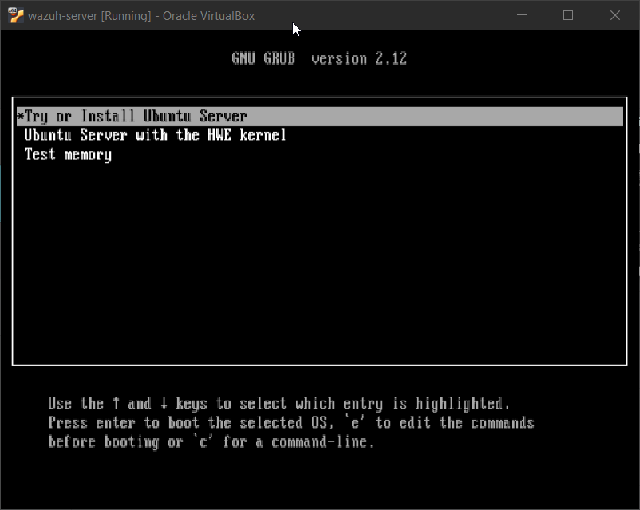](../screenshots/01-ubuntu-installer-boot.png)
*Booting the Ubuntu Server 24.04 installer in VirtualBox.*

[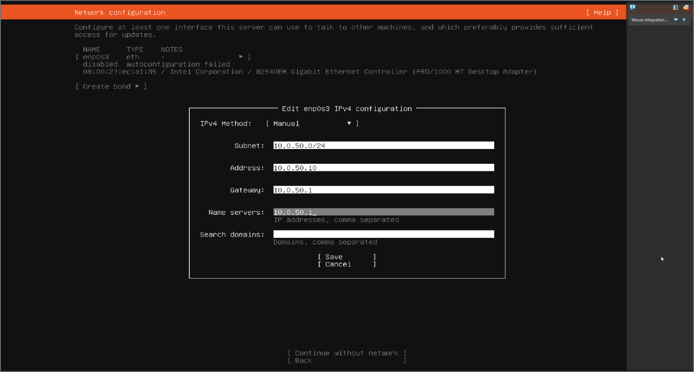](../screenshots/02-static-ip.png)
*Static IP set during install: address 10.0.50.10/24, gateway and DNS 10.0.50.1 (the NAT network has DHCP off).*

[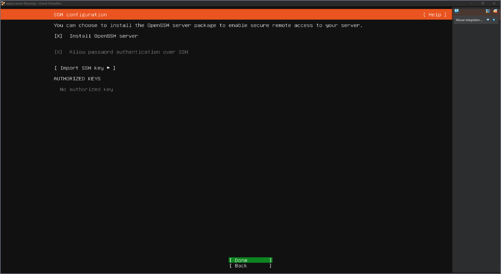](../screenshots/03-openssh.png)
*Enabling the OpenSSH server so the host can manage the VM over SSH.*

[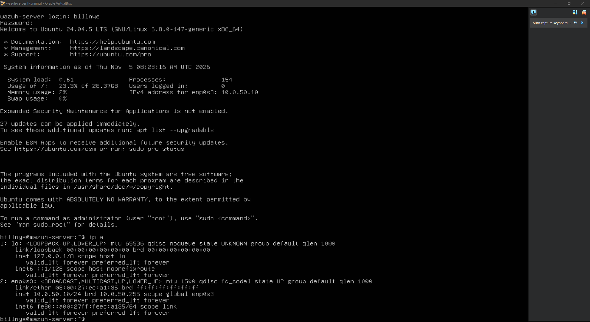](../screenshots/04-ip-a.png)
*First boot: `ip a` confirms `enp0s3` has the static address 10.0.50.10/24, running Ubuntu 24.04.5 LTS.*

---

## Phase 3: Wazuh install on wazuh-server

Installed Wazuh 4.14 (manager, indexer, and dashboard) with the all-in-one assistant:

```
curl -sO https://packages.wazuh.com/4.14/wazuh-install.sh
sudo bash ./wazuh-install.sh -a
```

The first run failed; recovering it is documented in Troubleshooting #3 and #4 below. After expanding the disk and clearing a leftover install, the second run (`-a -o`) completed. All three services came up `active (running)`, with the dashboard listening on 443. Reached it from the host browser at `https://localhost:8443` (through the SIEMLab port forward) and logged in as `admin`.

[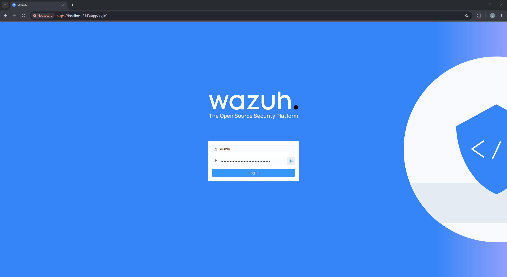](../screenshots/07-wazuh-login.png)
*The Wazuh dashboard login, reached from the host at https://localhost:8443.*

[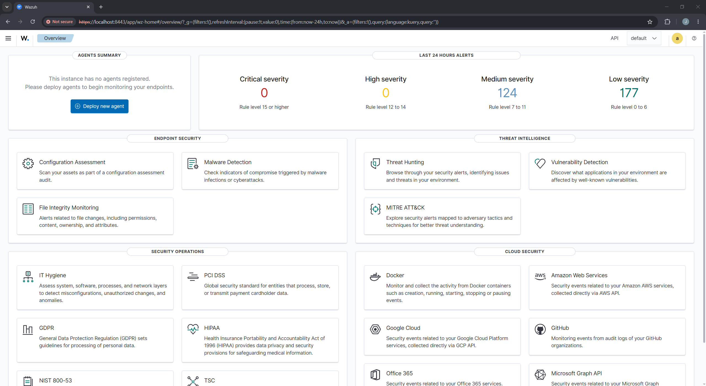](../screenshots/08-wazuh-dashboard.png)
*The Wazuh overview after first login. No agents are registered yet (endpoints come next); the medium/low alert counts are the server monitoring itself.*

> 💡 Managing the server over SSH from the host (`ssh billnye@127.0.0.1 -p 2210`, via the port forward) made troubleshooting far easier than typing in the VM console, mostly because it allows copy and paste.

---

## Phase 4: Linux endpoint (linux-endpoint)

Installed Ubuntu Server 24.04 on `linux-endpoint` with the static IP `10.0.50.30`. This time I left **LVM off** at the storage step, so root uses the whole disk directly and the disk-space problem from the server can't recur here.

Then installed the Wazuh agent and enrolled it against the manager:

```
curl -s https://packages.wazuh.com/key/GPG-KEY-WAZUH | sudo gpg --no-default-keyring --keyring gnupg-ring:/usr/share/keyrings/wazuh.gpg --import && sudo chmod 644 /usr/share/keyrings/wazuh.gpg
echo "deb [signed-by=/usr/share/keyrings/wazuh.gpg] https://packages.wazuh.com/4.x/apt/ stable main" | sudo tee /etc/apt/sources.list.d/wazuh.list
sudo apt-get update
sudo WAZUH_MANAGER="10.0.50.10" WAZUH_AGENT_NAME="linux-endpoint" apt-get install -y wazuh-agent
sudo systemctl daemon-reload && sudo systemctl enable --now wazuh-agent
```

The `WAZUH_MANAGER="10.0.50.10"` variable is what points the agent at the server and enrolls it. The agent registered as **agent 001** and shows **active** in the dashboard.

[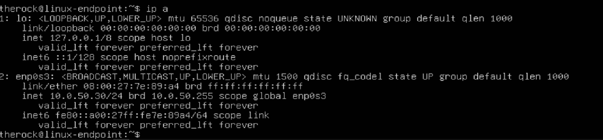](../screenshots/09-linux-ip-a.png)
*`linux-endpoint` on the lab network at 10.0.50.30.*

[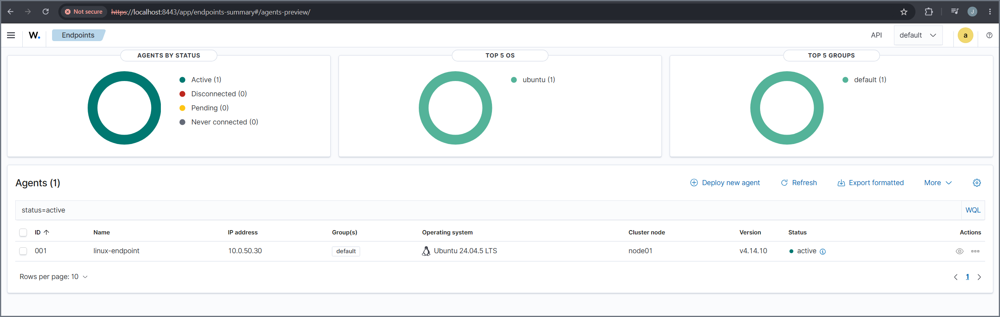](../screenshots/10-linux-agent-active.png)
*The Wazuh Endpoints view: `linux-endpoint` (agent 001) reporting as active, running Ubuntu 24.04.5 LTS.*

> 💡 The server and the endpoints are separate VMs, so the agent and the dashboard only work while `wazuh-server` is also running. The dashboard was unreachable and the agent could not enroll at first because the server VM was powered off; starting it fixed both. The agent-log line `Buffer agent.conf updated` confirms a live connection to the manager.

---

## Phase 5: Windows endpoint (win-endpoint)

Installed Windows 11 Enterprise (evaluation) on `win-endpoint`. VirtualBox's unattended install created the local user automatically, so Windows booted straight to the desktop with no Microsoft-account step. Set a static IP of `10.0.50.20` through the Windows network settings, and confirmed the box could reach the manager (`ping 10.0.50.10` replied).

Installed the Wazuh agent from PowerShell (admin), pointing it at the manager:

```
msiexec.exe /i wazuh-agent-4.14.10-1.msi /qn WAZUH_MANAGER="10.0.50.10" WAZUH_AGENT_NAME="win-endpoint"
```

The agent registered as **agent 002** and shows **active**. Then made the host detection-ready:

- **Audit policies** (so logons, account changes and group changes are logged): enabled Logon, User Account Management, and Security Group Management via `auditpol`.
- **PowerShell Script Block Logging** enabled (Event ID 4104) so encoded commands are captured.
- **Sysmon** installed with the SwiftOnSecurity config; it validated and is logging Event ID 1 (process creation).

[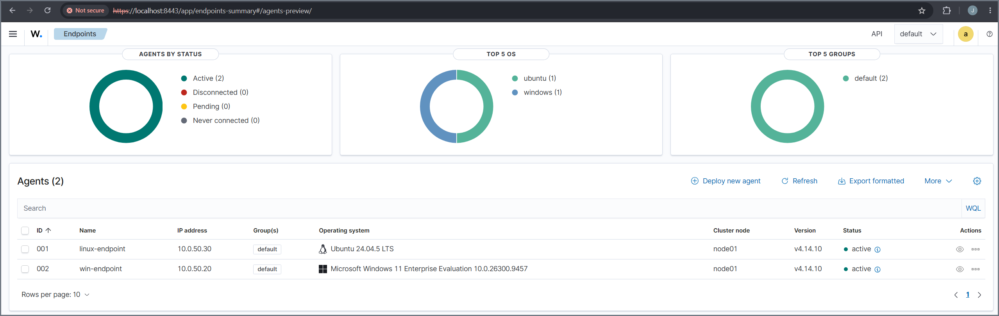](../screenshots/11-both-agents-active.png)
*Both endpoints reporting: `linux-endpoint` (001, 10.0.50.30) and `win-endpoint` (002, 10.0.50.20), each active.*

> 💡 The agent is active now, but Sysmon and PowerShell logs will not reach Wazuh until the shared `agent.conf` (which subscribes the agent to those event channels) is loaded on the server. That happens in the detection-rules phase, alongside `local_rules.xml`.

> 💡 VirtualBox notes for this VM: host-to-guest clipboard needed a Guest Additions reinstall before it worked, and with a keyboard that has no right Ctrl (the default VirtualBox Host key), the full-screen menu is reached by moving the mouse to the screen edge to reveal the toolbar, or by rebinding the Host key in VirtualBox preferences.

---

## Phase 6: Detection rules loaded, first detection validated

Copied `local_rules.xml` and the shared `agent.conf` from the repo to the server with `scp` (via the SSH port forward), placed them, and restarted the manager:

```
scp -P 2210 local_rules.xml agent.conf billnye@127.0.0.1:/tmp/     # from the host
sudo cp /tmp/local_rules.xml /var/ossec/etc/rules/local_rules.xml  # on the server
sudo cp /tmp/agent.conf /var/ossec/etc/shared/default/agent.conf
sudo chown wazuh:wazuh /var/ossec/etc/rules/local_rules.xml /var/ossec/etc/shared/default/agent.conf
sudo systemctl restart wazuh-manager
```

The manager came back up `active (running)`, which confirms `local_rules.xml` parsed with no errors. The Windows agent then pulled the shared `agent.conf`, subscribing it to the Sysmon and PowerShell event channels.

**First detection, validated end to end.** Ran a harmless encoded PowerShell command on `win-endpoint` (the encoded text just runs `whoami; hostname`), and custom rule **100100** fired at level 13, with the MITRE mapping auto-populated (`T1059.001`, tactic Execution).

[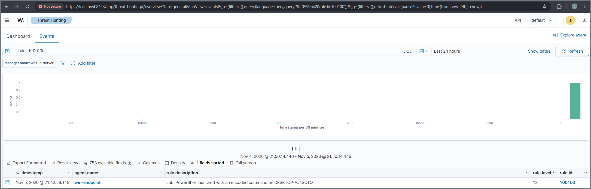](../screenshots/12-detection-encoded-ps-table.png)
*Threat Hunting, filtered to `rule.id:100100`: one hit from `win-endpoint`, "PowerShell launched with an encoded command," level 13.*

[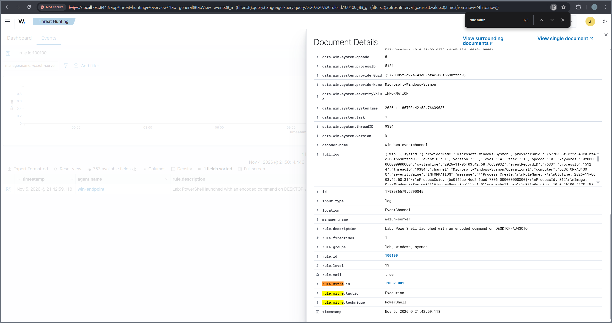](../screenshots/13-detection-encoded-ps-detail.png)
*The full alert document: the Sysmon process-creation event and the auto-populated `rule.mitre.*` fields.*

**All five rules validated.** Ran the remaining simulations (a PowerShell web download, a `schtasks` persistence entry, and adding an account to the local Administrators group on Windows; an `/etc/shadow` read with sudo on Linux). Every custom rule fired with the correct level and MITRE technique.

[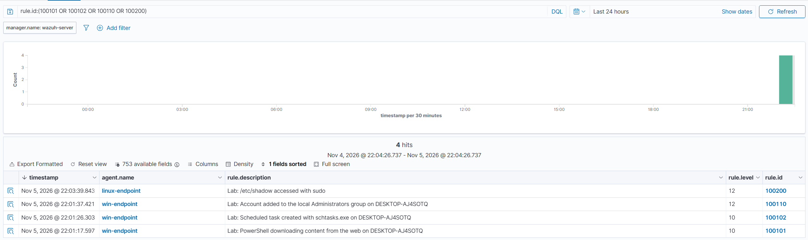](../screenshots/14-all-custom-rules.png)
*Threat Hunting filtered to the lab rules: 100101, 100102, 100110 (win-endpoint) and 100200 (linux-endpoint), each with the expected description and level. With 100100 from earlier, all five are confirmed.*

> 💡 On the first attempt the Windows agent pulled an empty `agent.conf`, so no Sysmon logs flowed. The cause was a multi-line paste that split the server-side `cp` commands, so the custom `agent.conf` never replaced the default. Re-running the copies one line at a time (and confirming the file with `head`) fixed it. Lesson: paste multi-line command blocks one line at a time over SSH, and verify a config is actually in place before assuming it loaded.

---

## Phase 7: Kali attacker and SSH brute force

Imported the prebuilt Kali VM (VirtualBox appliance via **Machine > Add**), attached it to the SIEMLab network, and gave it the static IP `10.0.50.40`. Created a deliberately weak target account `labvictim` on `linux-endpoint`, then ran an SSH brute force from Kali with Hydra, using the lab wordlist pulled from this repo:

```
hydra -l labvictim -P ~/lab-passwords.txt -t 4 -f ssh://10.0.50.30
```

Hydra worked through the list, failed on the first ~19 passwords, and cracked the account on `Summer2026!` (the last entry). Logging in with the cracked credentials then produced the success event. Wazuh's built-in rules captured the whole chain:

- rule 5760 (level 5) — repeated SSH authentication failures
- rule 5763 (level 10) — SSH brute force (fires after 8 failures in 120s)
- rule 5715 (level 3) — successful SSH login

[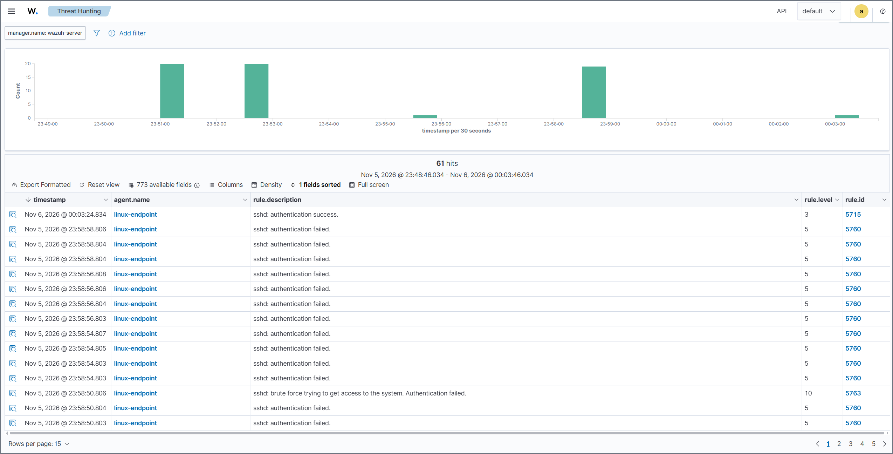](../screenshots/15-ssh-bruteforce.png)
*61 events from `linux-endpoint`: the failed-login burst (5760), the brute-force correlation alert (5763), and the successful login with the cracked credentials (5715).*

> 💡 Two gotchas worth noting: (1) the first Hydra run found nothing because the target account's password was never actually set, the `chpasswd` line had been dropped from a split multi-line paste; re-running it alone fixed it. (2) Hydra verifies a password but often resets the connection before sshd logs "Accepted", so rule 5715 did not fire from Hydra itself. A normal manual login with the cracked credentials (exactly what an attacker does next) generated it, which also makes the attack story more realistic.

---

## Phase 8: SOC overview dashboard

Built a custom **SIEM Lab Overview** dashboard in Wazuh (Explore > Visualize for the panels, Explore > Dashboards to assemble), with four panels against the `wazuh-alerts-*` index:

- **Top Triggered Rules** (data table, terms on `rule.description`)
- **Alerts Over Time** (vertical bar, date histogram on `timestamp`, split by `agent.name`)
- **MITRE Techniques** (data table, terms on `rule.mitre.technique`)
- **Total Alerts** (metric, count)

[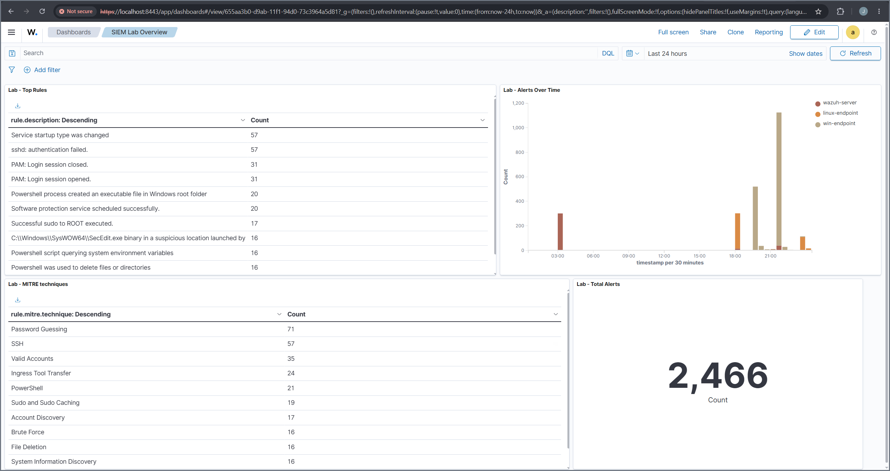](../screenshots/16-soc-dashboard.png)
*The finished dashboard. The MITRE techniques panel reflects the simulations: Password Guessing, SSH, Valid Accounts, Ingress Tool Transfer, PowerShell, Brute Force, and more.*

Wazuh also ships built-in MITRE ATT&CK views (a framework matrix and a charts dashboard) that map every alert to a technique, corroborating the lab's coverage with no extra build.

[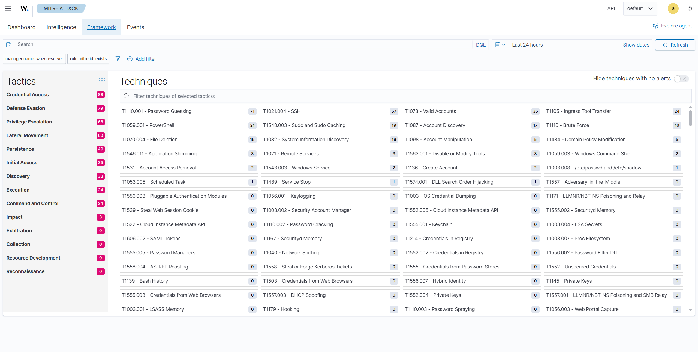](../screenshots/18-mitre-framework.png)
*The ATT&CK framework view, techniques lit up by the simulations.*

A sample of the underlying telemetry: a single Sysmon process-creation event carries the full command line, file hashes, parent process, and user, the raw data the detection rules match on.

[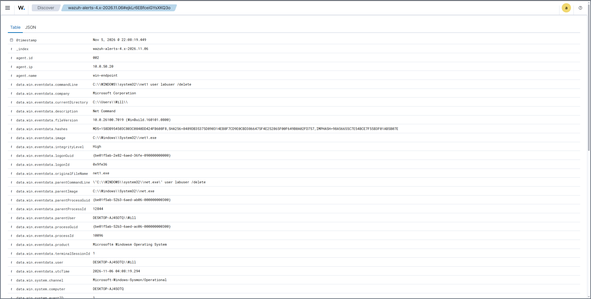](../screenshots/20-sysmon-event-1.png)
*One Sysmon process-creation event from `win-endpoint`, with command line, hashes, and parent-process fields.*

---

## Troubleshooting

### 1. VT-x disabled in BIOS (VM would not start)

**Symptom.** Starting `wazuh-server` failed immediately with:

```
not in a hypervisor partition (HVP=0) (VERR_NEM_NOT_AVAILABLE)
VT-x is disabled in the BIOS for all CPU modes (VERR_VMX_MSR_ALL_VMX_DISABLED)
```

**Cause.** Hardware virtualization (Intel VT-x) was turned off in the host's BIOS. VirtualBox needs it to run 64-bit guests, so the VM could not launch (and, as noted above, 64-bit guest types were hidden in the VM wizard).

**Fix.** Enabled virtualization in UEFI firmware:

1. Windows **Settings > System > Recovery > Advanced startup > Restart now**.
2. **Troubleshoot > Advanced options > UEFI Firmware Settings > Restart**.
3. In the firmware, enabled **Intel (VMX) Virtualization Technology** (VMX is Intel's internal name for VT-x, which is exactly what `VERR_VMX_...` refers to).
4. Save and exit (F10), reboot.

After enabling it, the VM started and the installer booted normally.

> 💡 Lesson: enable VT-x first. Without it, VirtualBox both refuses to start VMs and hides the 64-bit guest options, which makes the earlier "no 64-bit Ubuntu" symptom look like a separate problem when it is the same root cause.

### 2. "Failed unmounting cdrom.mount - /cdrom" on post-install reboot

**Symptom.** At the end of the Ubuntu install, on the reboot, the console printed:

```
[FAILED] Failed unmounting cdrom.mount - /cdrom.
```

**Meaning.** Harmless. The installer could not cleanly unmount the install ISO because it was still attached to the VM's virtual optical drive. It is not an installation failure.

**Fix.** Powered the VM off, confirmed the optical drive was empty under **Settings > Storage** (VirtualBox had already auto-ejected the ISO), and booted again. The VM then came up to the normal login prompt instead of relaunching the installer.

> 💡 Lesson: this message at install-reboot is expected in VirtualBox and safe to ignore. If the VM boots back into the installer, the ISO is still attached; remove it from the optical drive and boot again.

### 3. Wazuh install failed: "No space left on device"

**Symptom.** The first `wazuh-install.sh -a` run failed partway: the dashboard step errored and the manager service refused to start. The install log showed the real cause:

```
E: Write error - write (28: No space left on device)
ERROR: Wazuh dashboard installation failed.
```

**Cause.** The Ubuntu Server installer's default LVM layout gave the root filesystem only ~29 GB of the 60 GB virtual disk; the other ~29 GB sat unallocated in the volume group. Wazuh's indexer and dashboard filled the 29 GB, so the install aborted and rolled itself back.

**Fix.** Expanded the root logical volume to use the whole disk, then grew the filesystem onto it:

```
sudo lvextend -l +100%FREE /dev/ubuntu-vg/ubuntu-lv
sudo resize2fs /dev/ubuntu-vg/ubuntu-lv
```

`df -h /` then showed ~57 GB, with no data loss.

[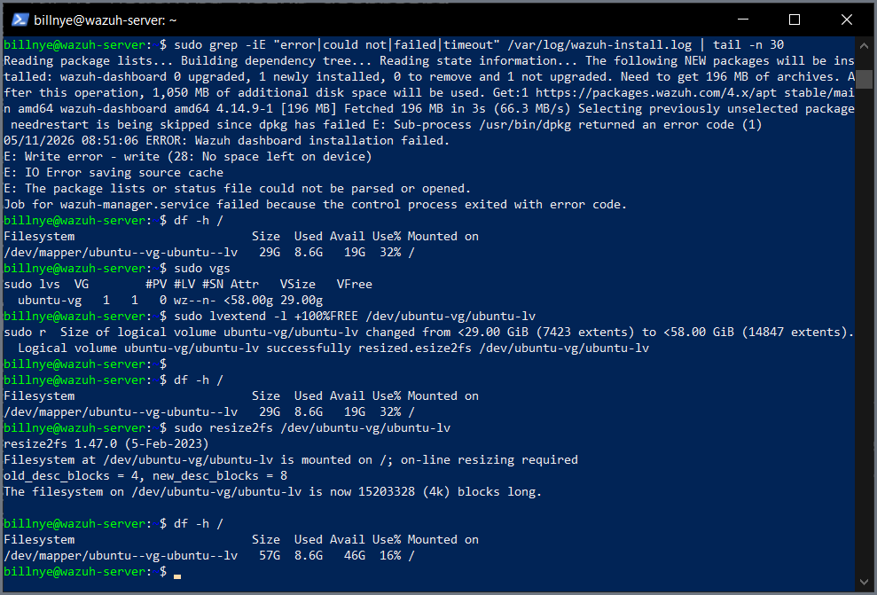](../screenshots/05-disk-space-fix.png)
*The full sequence: the "No space left on device" error, diagnosing with `df`/`vgs`, expanding the volume with `lvextend` + `resize2fs`, and `df` confirming root grew from 29 GB to 57 GB.*

> 💡 Lesson: Ubuntu Server's guided install often allocates only part of the disk to the root LVM volume. Check `df -h /` early; if root is smaller than the disk you created, `lvextend -l +100%FREE` plus `resize2fs` claims the rest. On the later `linux-endpoint` install I avoided the problem entirely by leaving **LVM off** at the storage step (Phase 4), which gives root the whole disk from the start.

### 4. Reinstall blocked: ports 1515/55000 in use and a wedged package

**Symptom.** Re-running the installer failed with:

```
ERROR: Port 1515 is being used by another process.
ERROR: Port 55000 is being used by another process.
```

and removing the leftover manager failed:

```
dpkg: error processing package wazuh-manager (--remove):
 installed wazuh-manager package pre-removal script subprocess returned error exit status 127
```

**Cause.** The first, half-finished install left the `wazuh-manager` package partly installed, with its processes still running and holding the agent-enrollment (1515) and API (55000) ports. Its removal script failed (exit 127: it called a Wazuh binary that had already been deleted), so neither the installer nor `apt` could clean it up.

**Fix.** Deleted the broken maintainer scripts so dpkg could finish, purged the package, killed the stragglers, and removed the leftover directory:

```
sudo rm -f /var/lib/dpkg/info/wazuh-manager.prerm /var/lib/dpkg/info/wazuh-manager.postrm
sudo dpkg --purge wazuh-manager
sudo pkill -9 -f wazuh
sudo rm -rf /var/ossec
```

With the ports free and the package gone, `sudo bash ./wazuh-install.sh -a -o` completed cleanly.

> 💡 Lesson: a package whose removal script exits 127 is usually missing a file the script expects. Deleting the stale `prerm`/`postrm` scripts under `/var/lib/dpkg/info/` lets dpkg finish the removal; then clear leftover files and ports by hand.

---

## Next up

- Add a "What I Learned" reflection to the README (personal takeaways).
- Final pass on the README once the lab is closed out.
